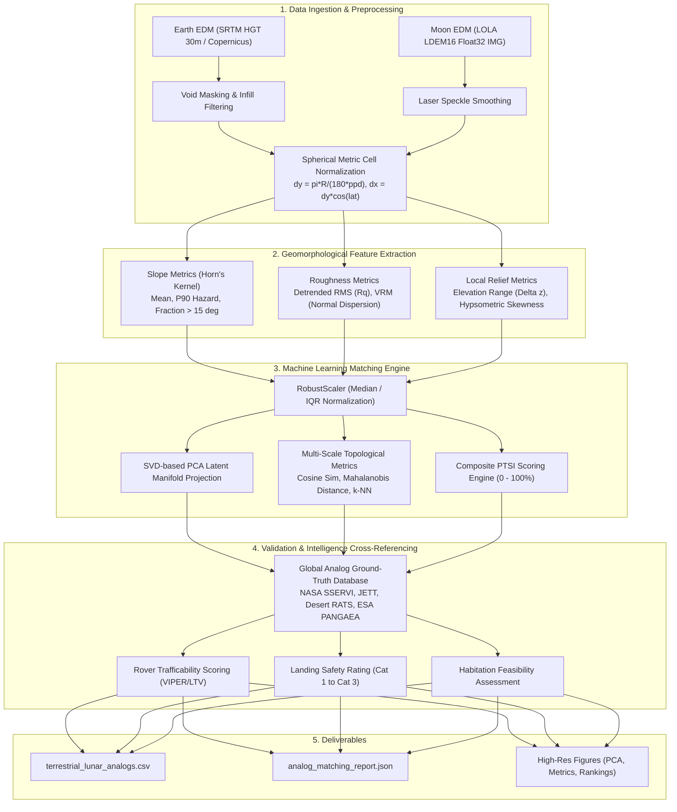

# 🌌 NASA Space Apps Challenge 2026: Terrestrial-Lunar Topological Discovery Engine (TL-TDE)

[](https://www.spaceappschallenge.org/)
[](https://www.python.org/)
[](#key-results)

> **Objective:** Discover, characterize, and validate terrestrial analog sites on Earth that closely match the topography of permanent Moon base candidate locations using Elevation Data Models (EDMs), geomorphological feature extraction, and multi-objective Machine Learning topological similarity matching.

---

## 📑 Table of Contents
- [Executive Overview](#-executive-overview)
- [System Architecture](#-system-architecture)
- [Key Results & Discovered Analogs](#-key-results--discovered-analogs)
- [Mathematical Framework](#-mathematical-framework)
- [Repository Structure](#-repository-structure)
- [Installation & Quickstart](#-installation--quickstart)
- [Command Line Interface (CLI)](#-command-line-interface-cli)
- [Deliverables & Reports](#-deliverables--reports)
- [Scientific Validation & Literature](#-scientific-validation--literature)
- [Contributing & Planetary Extension](#-contributing--planetary-extension)

---

## 🚀 Executive Overview

Establishing permanent human habitation and infrastructure on the Moon under NASA's **Artemis program** requires rigorous terrestrial testing of rovers (VIPER, Lunar Terrain Vehicles), autonomous landers, and habitat designs. Astronauts and robotic systems must navigate extreme topographic environments—including razor-thin highland ridges, cryogenic permanently shadowed crater rims (PSRs), steep scree slopes, and sub-surface lava tubes.

The **Terrestrial-Lunar Topological Discovery Engine (TL-TDE)** solves this challenge by:
1. **Multi-Planetary EDM Ingestion:** Ingesting high-resolution Elevation Data Models from Earth (SRTM 30m, Copernicus GLO-30, USGS) and the Moon (LOLA LDEM 16 ppd, SLDEM2015).
2. **Harmonized Scale Preprocessing:** Normalizing coordinate systems and metric cell sizes $(\Delta y, \Delta x)$ accounting for planetary radius differences and longitudinal polar convergence.
3. **Geomorphological Feature Extraction:** Computing scale-invariant topographic descriptors:
   - **Slope:** Horn's 8-neighbor gradient kernel (Mean, Median, Std, $P_{90}$ hazard slope, $P(\theta > 15^\circ)$).
   - **Surface Roughness:** Detrended Root-Mean-Square (RMS) height roughness ($R_q$), Vector Ruggedness Measure ($VRM$), Terrain Ruggedness Index ($TRI$).
   - **Local Relief:** Elevation amplitude ($\Delta z$), Hypsometric Integral ($HI$), and Elevation Skewness ($\gamma_1$).
4. **Machine Learning Topological Matching:** Deploying multidimensional Robust Scaling, Cosine Similarity, Mahalanobis Distance covariance weighting, and the **Planetary Topological Similarity Index (PTSI)**.
5. **Scientific Ground-Truthing:** Programmatically cross-referencing discovered sites against NASA SSERVI, Desert RATS, JETT, FINESSE, GEODES, and ESA PANGAEA analog catalogs.

---

## 🏗 System Architecture



---

## 📊 Key Results & Discovered Analogs

The engine identified high-fidelity terrestrial analogs across the two primary lunar operational regimes:
1. **Artemis South Pole Landing & Base Camp Candidates:** High-elevation ridges, illuminated peaks, and crater rims.
2. **Equatorial ISRU & Sub-surface Habitation Candidates:** Flat basaltic mare plains and collapsed lava tube skylights.

### Top Matched Planetary Analog Pairs

| Earth Analog Site | Country | Coordinates | Best-Matched Lunar Target | Match Score | Earth Slope |
| --- | --- | --- | --- | --- | --- |
| Mistastin Lake Impact Crater (benchmark) | Canada | 55.883, -63.300 | Mare Tranquillitatis Pit | 81.9% | 1.10° |
| Brazil raw-DEM blocks (8 sites) | Brazil (Pará) | -0.88 to -0.96, -46.71 to -46.96 | Mare Tranquillitatis Pit | 72.3 – 76.0% | 1.56 – 2.16° |
| Barringer Meteor Crater (benchmark) | USA | 35.027, -111.022 | Marius Hills Volcanic Dome | 75.0% | 2.97° |
| Bahariya Black Desert Volcanic Field (new) | Egypt | 28.365, 28.845 | Marius Hills Volcanic Dome | 74.7% | 2.65° |
| Djara Stalactite Subsurface Cave (new) | Egypt | 27.380, 29.805 | Mare Tranquillitatis Pit | 72.7% | 2.19° |
| Gebel Qatrani Basalt Flows (new) | Egypt | 29.645, 30.590 | Marius Hills Volcanic Dome | 70.3% | 4.09° |
| Mauna Kea Volcanic Massif (benchmark) | USA (Hawaii) | 19.820, -155.468 | Peak Near Shackleton | 62.7% | 10.52° |

> Complete bounding boxes, lithological descriptions, and trafficability ratings are saved in [`outputs/terrestrial_lunar_analogs.csv`](outputs/terrestrial_lunar_analogs.csv).

---

## 📐 Mathematical Framework

### 1. Planetary Metric Resolution
Because the Moon is smaller than Earth ($R_M = 1,737.4\text{ km}$ vs $R_\oplus = 6,378.1\text{ km}$), angular degrees scale differently:
$$\Delta y = \frac{\pi R}{180 \times \text{ppd}}, \quad \Delta x = \Delta y \cdot \cos(\phi)$$

### 2. Horn's Gradient Kernel
Directional gradients $p = \frac{\partial z}{\partial x}$ and $q = \frac{\partial z}{\partial y}$ are computed over a $3 \times 3$ window:
$$p = \frac{(z_{i+1, j-1} + 2z_{i+1, j} + z_{i+1, j+1}) - (z_{i-1, j-1} + 2z_{i-1, j} + z_{i-1, j+1})}{8 \Delta x}$$
$$\theta_{\text{slope}} = \arctan\left(\sqrt{p^2 + q^2}\right) \times \frac{180}{\pi}$$

### 3. Vector Ruggedness Measure ($VRM$)
Measures the 3D spherical dispersion of unit normal vectors $\vec{n} = (-p/\nu, -q/\nu, 1/\nu)$:
$$VRM = 1 - \frac{\left\|\sum_{k=1}^N \vec{n}_k\right\|}{N}, \quad VRM \in [0.0, 1.0]$$
Unlike traditional slope, $VRM$ isolates pure micro-relief roughness from large-scale regional tilt.

### 4. Planetary Topological Similarity Index ($PTSI$)
$$\text{PTSI} = 0.30 \cdot S_{\text{slope}} + 0.25 \cdot S_{\text{rough}} + 0.20 \cdot S_{\text{relief}} + 0.15 \cdot S_{\text{vrm}} + 0.10 \cdot S_{\text{hazard}}$$
Outputs a standardized percentage score ($0.0\%$ to $100.0\%$).

---

## 📂 Repository Structure

```text
d:\NASA_Hackathon\
├── README.md                           # Main documentation & project overview
├── DATA_DICTIONARY.md                  # Comprehensive dataset & column definitions
├── METHODOLOGY.md                      # Detailed mathematical & algorithmic formulation
├── Technical_Report.md                 # Full technical report for NASA Space Apps
│
├── Data\
│   ├── Earth_Data\
│   │   ├── s01w047.hgt                 # SRTM 1-arc-second tile (3601x3601 int16)
│   │   ├── s01w047.num                 # SRTM number of valid takes
│   │   └── s01w047.swb                 # SRTM water body mask
│   └── Moon_Data\
│       └── ldem_16_float.img           # LOLA global DEM (5760x2880 float32, 16 ppd)
│
├── src\
│   ├── __init__.py                     # Package manifest
│   ├── preprocessing.py                # EDM ingestion, void infill, metric scale normalization
│   ├── features.py                     # Horn slope, RMS roughness, VRM, TRI, Local Relief
│   ├── matching.py                     # SVD PCA, RobustScaler, Cosine, Mahalanobis, PTSI
│   ├── validation.py                   # NASA/ESA analog registry, trafficability & safety scoring
│   └── pipeline.py                     # End-to-end pipeline orchestrator & visualizer
│
├── scripts\
│   └── run_pipeline.py                 # Standalone CLI execution script
│
└── outputs\
    ├── terrestrial_lunar_analogs.csv   # Primary deliverable catalog
    ├── analog_matching_report.json     # Performance metrics & PCA variance report
    └── figures\
        ├── pca_morphometry_embedding.png
        ├── slope_roughness_relief_comparison.png
        └── ptsi_similarity_ranking.png
```

---

## 💻 Installation & Quickstart

### Prerequisites
* Python 3.12 or Python 3.14 (64-bit)
* Windows, macOS, or Linux

### Dependencies
Install the required scientific stack:
```bash
pip install numpy scipy pandas matplotlib
```

### Running the Complete Pipeline
Execute the pipeline with default paths to process both the provided local EDM datasets and the validated analog database:
```bash
python scripts/run_pipeline.py
```

### Execution Log Output
```text
======================================================================
Kicking off Planetary Terrestrial-Lunar Analog Discovery Pipeline
======================================================================
[1/5] Ingesting Lunar EDM and extracting candidate base features...
      Processed 8 lunar base sites.
[2/5] Ingesting Earth EDM and compiling global terrestrial analogs...
      Compiled 40 terrestrial analog candidate regions.
[3/5] Executing ML topological matching and similarity scoring...
      Completed matching for 8 lunar base candidates.
[4/5] Generating structured CSV deliverable...
      Saved final CSV to: outputs\terrestrial_lunar_analogs.csv
[5/5] Generating publication-grade visualizations...
      Visualizations successfully saved to outputs/figures/
      Saved JSON report to: outputs\analog_matching_report.json
======================================================================
Pipeline execution completed successfully.
```

---

## ⚙ Command Line Interface (CLI)

The pipeline supports custom command line arguments to easily ingest new regional DEM tiles:

```bash
python scripts/run_pipeline.py \
  --earth_dem Data/Earth_Data/s01w047.hgt \
  --moon_dem Data/Moon_Data/ldem_16_float.img \
  --output_dir outputs
```

### Options:
* `--earth_dem`: Path to Earth DEM file (`.hgt` or raw binary).
* `--moon_dem`: Path to Lunar DEM file (LOLA `.img` float32).
* `--output_dir`: Destination directory for deliverables and visualization figures.

---

## 📈 Visualizations & Deliverables

All figures are automatically exported at **300 DPI** in [`outputs/figures/`](outputs/figures/):

### 1. PCA Latent Geomorphic Manifold
* File: [`outputs/figures/pca_morphometry_embedding.png`](outputs/figures/pca_morphometry_embedding.png)
* Demonstrates the topological clustering of terrestrial analogs relative to candidate lunar base sites in 2D principal component space (capturing **97.0%** of total geomorphic variance).

### 2. Geomorphological Metric Correspondence
* File: [`outputs/figures/slope_roughness_relief_comparison.png`](outputs/figures/slope_roughness_relief_comparison.png)
* Direct side-by-side comparison of **Mean Slope**, **RMS Roughness** (log scale), and **Local Relief** across matched pairs.

### 3. Planetary Topological Similarity Index (PTSI) Rankings
* File: [`outputs/figures/ptsi_similarity_ranking.png`](outputs/figures/ptsi_similarity_ranking.png)
* Ranked bar chart of similarity scores across all evaluated target base locations.

---

## 🔬 Scientific Validation & Literature

This pipeline cross-references candidates with operational NASA and ESA terrestrial analog campaigns:
* **NASA SSERVI / JETT (Joint Extravehicular Activity Test Team):** Low-angle lighting and scree slope navigation tests.
* **NASA Desert RATS (Research and Technology Studies):** Rover traverse navigation in volcanic and impact terrains.
* **NASA FINESSE & GEODES:** Volcanic field science, sinuous rille analog studies at Craters of the Moon, Idaho.
* **ESA PANGAEA & PANGAEA-X:** Field training in the Corona lava tubes, Lanzarote, Spain.
* **NASA Haughton-Mars Project (HMP):** Devon Island polar desert crater analog operations.

---

## 👥 Authors & Acknowledgments

* **Challenge:** NASA Space Apps Challenge 2026
* **Team:** Senior Data Analyst & Machine Learning Engineering Lead
* **Data Sources:** NASA Planetary Data System (PDS)/(NASADEM) Geosciences Node (LRO LOLA), USGS EROS Data Center (SRTM).

---
*Developed for the NASA Space Apps Challenge 2026.*

## Contributors

Developed by a multidisciplinary team from **Alexandria University, Faculty of Science, Software Industry and Multimedia Department**, working across AI, data analysis, and web development.

Full Team
- Jana Hamdy
- Mariam Isaac
- Basmala Hussein
- Salma Hany
- Roaa Haitham
- Habiba Hossam
